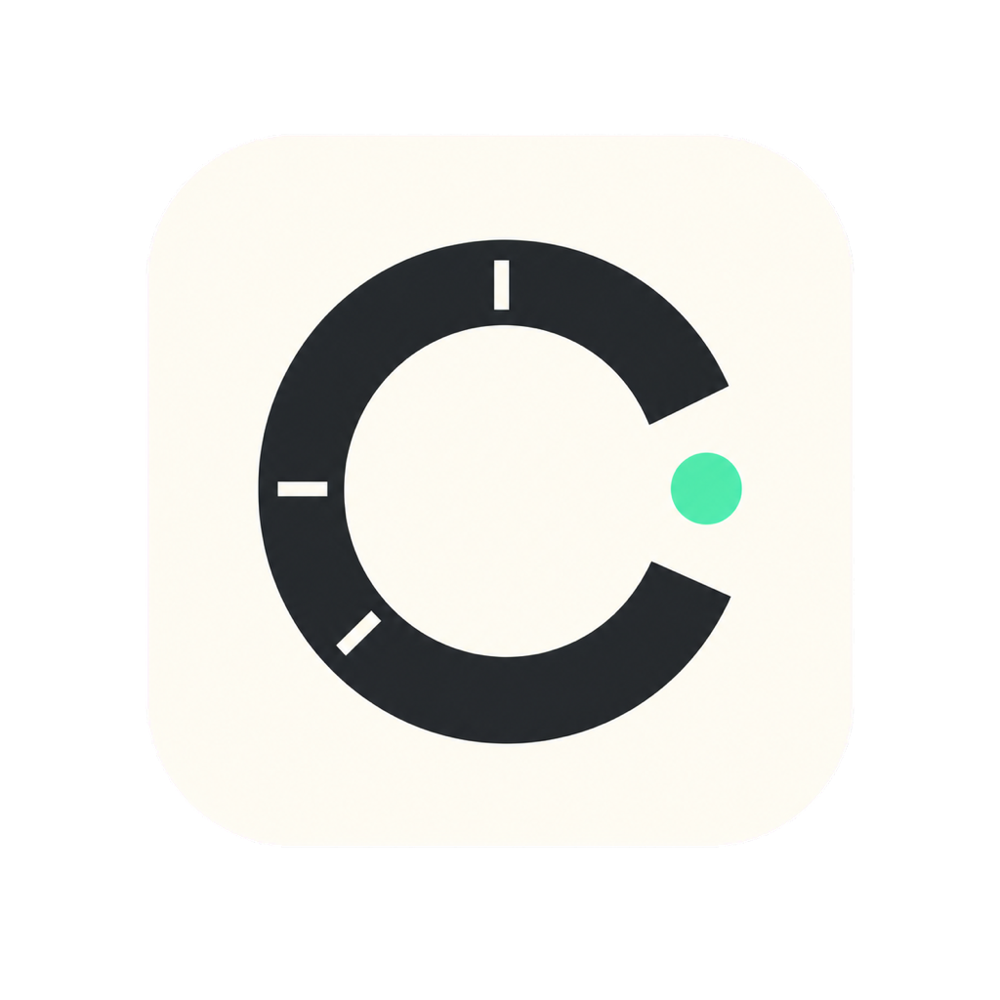

# CodexMeter

<p align="center">
  
</p>

<p align="center">
  <a href="./README.md">English</a> · <strong>简体中文</strong>
</p>

CodexMeter 是一枚原生、本地优先的 macOS 菜单栏用量小组件，可快速查看 Codex 当前剩余额度、重置时间与当天 Token 使用量。界面采用 SwiftUI + AppKit、系统毛玻璃材质和流畅的状态动效。

> CodexMeter 是独立社区项目，与 OpenAI 不存在隶属或官方认可关系。项目没有自建后端，但本机 Codex app-server 会使用你现有的 Codex 登录态访问 OpenAI 服务。

## 功能

- 显示 Codex 速率限制窗口、剩余比例与实时 5 小时重置倒计时。
- 显示账户服务返回的当天 Token 活动汇总。
- 支持三种小组件模式：
  - **始终置顶**：跨桌面空间显示，并保持在普通窗口上方。
  - **固定桌面**：停留在普通窗口后方，作为低干扰桌面插件。
  - **隐藏**：暂时收起，并可从菜单栏随时恢复。
- 提供独立的**最小化布局**，只保留主额度圆环、圆形原生毛玻璃背景和圆环中央内容；完整面板会连续收拢到该圆环，并从圆环展开恢复，也可通过圆环右键菜单、菜单栏或设置恢复。
- 默认自动跟随 macOS 语言，并可在设置中即时切换 English 或简体中文。
- 支持系统毛玻璃、圆角、浅色/深色外观、减少动态效果和降低透明度。
- 常驻菜单栏，不占用 Dock（`LSUIElement`）。
- 完全本地运行，没有项目自建服务器、广告或遥测。

## 语言

CodexMeter 默认跟随 macOS 语言。在 **设置 → 语言** 中可以选择：

- **跟随系统**
- **English**
- **简体中文**

切换后无需重启，浮窗、菜单栏、设置、无障碍文案、日期、数字、倒计时和应用生成的错误提示都会立即更新。所有中文系统语言都会使用简体中文翻译；其他不受支持的系统语言默认使用 English。

## 环境要求

- macOS 14 Sonoma 或更高版本。
- Xcode 26 或兼容的 Swift 6.2 工具链。
- 已安装 Codex/ChatGPT 桌面应用，或 Codex CLI 已登录 ChatGPT 账户。
- Codex 获取当前账户用量时需要联网。

可检查命令行登录状态：

```bash
codex login status
```

如果当前 Codex 版本没有该子命令，直接运行 `codex` 并按提示登录。

## 安装与运行

```bash
git clone https://github.com/paiiiii/CodexMeter.git
cd CodexMeter
./Scripts/install-local.sh
```

只安装、不自动打开：

```bash
./Scripts/install-local.sh --no-open
open "$HOME/Applications/CodexMeter.app"
```

自定义安装目录：

```bash
DIST_DIR="$PWD/dist" ./Scripts/install-local.sh
```

再次执行安装脚本即可更新；脚本只替换目标目录内的 `CodexMeter.app`。

## 数据来源

CodexMeter 启动本机 `codex app-server`，通过 stdio 上的 JSON-RPC 通信，主要读取：

- `account/rateLimits/read`：账户速率限制窗口与重置时间。
- `account/usage/read`：Token 汇总与每日用量桶。

登录和 Token 刷新由 Codex 管理。CodexMeter 不要求粘贴 API key，也不会复制或保存 Codex 认证文件。协议详情见 [OpenAI Codex app-server README](https://github.com/openai/codex/blob/main/codex-rs/app-server/README.md)。

## 架构

```text
SwiftUI 视图、本地化与动画
                    │
AppKit 窗口与菜单栏控制 ── 置顶、隐藏、桌面层与布局
                    │
可观察状态与定时刷新
                    │
本机 codex app-server（JSON-RPC / stdio）
                    │
account/rateLimits/read + account/usage/read
```

项目采用 Swift Package。可执行 Target 负责应用生命周期，`CodexMeterKit` 则包含用量模型、app-server 客户端、语言资源、UI 与可测试逻辑。Release 脚本会将可执行文件、`Info.plist`、AppIcon 和编译后的 SwiftPM 资源包组装成标准 `.app`。

## 设计系统

CodexMeter 使用项目专属的 **Signal & Silence** 设计系统，以“信息证据优先于装饰”、编辑式留白、语义化额度状态和原生 macOS 体验为核心。它让 5 小时额度保持最明确的主层级，同时让当天 Token 活动和更长周期信息清晰但不喧宾夺主。

- 阅读英文主文档 [Design System](docs/DESIGN_SYSTEM.md)。
- 查看机器可读的 [design tokens](tokens.json)。
- 所有可见改动都应按照 [Design QA matrix](docs/DESIGN_QA.md) 验证。

这套系统保留 CodexMeter 黑白克制的基调与薄荷绿品牌信号，并不会照搬其他产品的视觉配色。

可从 1024×1024 源图重新生成应用图标：

```bash
./Scripts/generate-icon.sh
```

## 构建与测试

```bash
swift test
./Scripts/build-app.sh
```

脚本会在可用时自动选择 `/Applications/Xcode.app/Contents/Developer`。默认产物位于 `~/Applications/CodexMeter.app`，并在系统支持时添加本地 ad-hoc 签名。

开发模式：

```bash
swift run CodexMeter
```

只有在明确希望访问真实 Codex app-server 时才运行可选集成测试：

```bash
CODEX_METER_LIVE_TESTS=1 swift test --filter LiveCodexIntegrationTests
```

## 隐私与安全

- 不包含第三方分析 SDK、行为跟踪或项目自建远程服务。
- 不读取、提交或打包 `.env`、API key、Codex 登录文件及常见凭据文件。
- app-server 使用现有 Codex 登录态向 OpenAI 请求账户用量；本地部署不等于离线统计。
- UI 仅供参考，不应被视为账单、发票或成本审计来源。
- 打包脚本只复制 Release 可执行文件、`Info.plist`、AppIcon 与声明的 SwiftPM 资源包。

漏洞报告方式见 [SECURITY.md](SECURITY.md)。

## 已知限制

- 必须存在兼容且已登录的 Codex/ChatGPT 桌面应用或 CLI 会话。
- `account/usage/read` 字段取决于 Codex 版本和账户类型，部分环境可能不返回当天 Token 总量。
- 剩余额度由服务返回的用量比例换算，不是固定 Token 池。
- 每日用量桶的结算边界由账户服务决定，可能不同于 Mac 本地午夜。
- 固定桌面模式通过 AppKit 窗口层级与 Spaces 行为模拟，不是 WidgetKit 扩展，也不会出现在 macOS 小组件图库。
- 轮询和速率限制通知可能短暂延迟，最终口径以 Codex/OpenAI 官方账户界面为准。
- 本机 app-server 会随 Codex 演进，升级后可能需要兼容性更新。

## 故障排查

**应用没有出现在 Dock 中**

这是预期行为。`Info.plist` 启用了 `LSUIElement`，请通过菜单栏和小组件窗口使用 CodexMeter。

**找不到 Codex 或一直显示未连接**

确认 Codex CLI 位于 `PATH`，或 Codex/ChatGPT 桌面应用已安装并登录，然后退出并重新打开 CodexMeter。自定义可执行文件可通过 `CODEX_METER_CODEX_PATH` 指定。

**Swift 使用了 Command Line Tools**

打包脚本会自动选择完整 Xcode。手动运行时可执行：

```bash
export DEVELOPER_DIR=/Applications/Xcode.app/Contents/Developer
swift test
```

## 参与贡献

欢迎贡献。提交 PR 前请阅读英文主文档 [CONTRIBUTING.md](CONTRIBUTING.md)。所有新增或修改的用户可见文案都必须同时提供 English 与简体中文资源。

版本历史见 [CHANGELOG.md](CHANGELOG.md)。

## 参考资料

- [OpenAI Codex app-server README](https://github.com/openai/codex/blob/main/codex-rs/app-server/README.md)
- [Apple：本地化 Swift Package 资源](https://developer.apple.com/documentation/xcode/localizing-package-resources)
- [Apple：LSUIElement](https://developer.apple.com/documentation/bundleresources/information-property-list/lsuielement)
- [Apple：NSWindow.Level.floating](https://developer.apple.com/documentation/appkit/nswindow/level-swift.struct/floating)
- [Apple：NSVisualEffectView](https://developer.apple.com/documentation/appkit/nsvisualeffectview)
- [Apple：WidgetKit](https://developer.apple.com/documentation/widgetkit)

## 许可证

CodexMeter 使用 [MIT License](LICENSE)。
